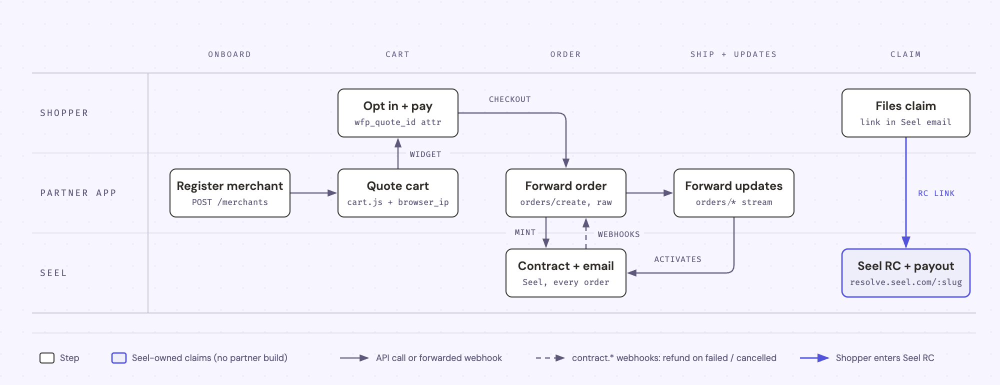

# Seel Shopify Partner Integration - Reference Implementation

A reference implementation for partners who sell Seel Worry-Free Delivery (WFD) to Shopify merchants through their own Shopify app. It has two parts. The storefront widget is a theme app extension. The partner backend talks to Seel's Shopify API (`/v1/shopify/*`).

Partners on Seel's direct `/v1/ecommerce/*` API should use [seel-direct-integration-reference](https://github.com/travisjoseph/seel-direct-integration-reference) instead. Merchants who install Seel's own Shopify app need neither repo.

The API calls the program WFP (Worry-Free Purchase), so API fields say `wfp` even where the product is sold as Worry-Free Delivery.

## How the pieces fit



| Tier | Who | Holds |
|---|---|---|
| Seel | Seel | Quotes, contracts, shopper emails, claims and payouts |
| Partner app | The company whose Shopify app embeds WFD | One Seel API key, the quote proxy, the order and webhook pipeline |
| Merchant | Each Shopify store that installs the partner app | One Seel merchant record, keyed by its `*.myshopify.com` domain |

1. The partner app registers each merchant with Seel.
2. The widget quotes the cart through the partner's quote proxy. The proxy adds the API key and the shopper's IP.
3. When the shopper opts in, the widget adds the WFD variant at quantity 1 and writes the quote id to the `wfp_quote_id` cart attribute.
4. The partner app forwards each Shopify order webhook to Seel as the raw order. Seel writes the contract and emails the shopper.
5. Seel sends contract webhooks back. The partner app refunds the WFD line on `contract.failed` and `contract.cancelled`.
6. Shoppers file claims in Seel's Resolution Center. Seel resolves and pays them. The partner builds no claims flow.

## Layout

| Path | What it is |
|---|---|
| `widget/extension/seel-wfd/` | The theme app extension. Pure logic sits in `seel-wfd-core.js`, and DOM and network code sits in `seel-wfd.js`. |
| `widget/demo/index.html` | Offline demo with a mocked cart, proxy and price ladder. Open it in a browser. |
| `widget/test/` | `node --test` suite for the widget core. |
| `server/node/` | Node 18+ backend with built-ins only. It runs the quote proxy, Shopify order forwarding, the Seel webhook endpoint and a merchant script. |
| `docs/partner-flow.html` | Source for the flow diagram above. |

The [widget README](widget/README.md) and the [server README](server/node/README.md) cover settings, routes and environment variables.

## Quickstart

The demo needs no keys.

```bash
open widget/demo/index.html
```

Run both test suites.

```bash
cd widget && node --test && cd ..
node --test server/node/test/*.test.js
```

Start the backend against sandbox. It reads the process environment and never loads a `.env` file. `server/node/.env.example` lists every variable.

```bash
cd server/node
SEEL_API_KEY=... SEEL_WEBHOOK_SECRET=... SEEL_SERVICE_TYPE=... \
SEEL_ALLOWED_SHOPS=your-store.myshopify.com SHOPIFY_API_SECRET=... \
node example-server.js
```

The server listens on `127.0.0.1:8787`. Point the widget's quote endpoint setting at its `/seel/quotes` route.

## Three rules that break contracts silently

Each of these has broken a partner integration without an error on any API call. The code in this repo follows all three.

1. **The cart attribute is `wfp_quote_id`.** Seel binds the order to its quote through this attribute. Seel accepts the older `ssp_quote_id` key without an error, but never binds the order and declines the contract.
2. **The quoted price must match a variant exactly.** Seel compares the premium on the order with the quote. Match against a net price ladder, not the `product.js` price, which is gross on tax-inclusive stores. If no variant matches, hide the widget. Never round up to the next tier.
3. **The WFD SKU is one fixed string on every variant.** Seel finds the WFD line by SKU. A per-tier suffix means Seel writes no contract and sends no `contract.failed`.

## What Seel provides

| Value | Where it goes |
|---|---|
| API key | `SEEL_API_KEY`, server only |
| Webhook secret | `SEEL_WEBHOOK_SECRET`, server only |
| Service type, such as `acme_shopify-wfp` | `SEEL_SERVICE_TYPE` and the widget's service type setting |
| WFD SKU | The widget's SKU setting and every WFD variant |
| Rate tables per currency | The WFD product's variants and its `seel.net_price_ladder` metafield |

Sandbox is `https://api-test.seel.com`. Production is `https://api.seel.com`. Seel issues production keys after it tests your app on a development store.

## What the partner still builds

- The Shopify Admin refund call behind the two refund hooks. The default hooks only log.
- A durable dedupe store in place of the in-memory one.
- Merchant lifecycle calls. Create the merchant on install, update it on disable or uninstall, and create or delete the WFD product to match.
- The 30-day order backfill through `POST /v1/shopify/orders/batch` when a merchant turns WFD on.
- A checkout UI extension if you sell to Shopify Plus merchants. This repo covers the cart widget only.
